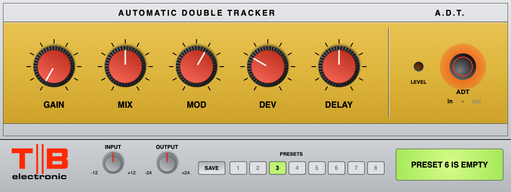

# TB Automatic Double Tracker (Mountain Lion VST)

A model of the **Bell Electrolabs A.D.T.** (Automatic Double Tracker) as a
**VST 2.4, 64-bit Intel plugin for Mac OS X 10.8.5** (Pro Tools 11 through Blue Cat
PatchWork). Non-commercial, for personal use. Built and tested on GitHub Actions.

## The circuit

Modelled from Krystal's trace (`Docs/Bell_ADT_schematic.pdf`). A gain stage, then an
MN3005 bucket brigade between an NE571 compander, with a 4046 clock swept by a 741
oscillator:

- **Input / GAIN**: C1 30n, R1 470K, U2 (LM741) non-inverting. GAIN (A100K) is a variable
  resistor from the output to the inverting input, over R4 1K + C3 10u: x1 to x101.
  U2's output is the direct signal (MIX's other end and the direct out jack).
- **Compressor** U4 channel 1 (NE571): fed through R6 33K || C7 3n3 (pre-emphasis), C8,
  C11 1u rectifier cap, C12 33p.
- **Filters**: C13 100n / R13 47K, then two Sallen-Key low-pass filters on BC184 emitter
  followers (33K / 33K with 660p / 220p, about 12.7 kHz, and 330p / 220p, about 17.9 kHz).
- **MN3005** (4096 stages), its two outputs averaged by TRIM2; C31 1n, R34 100K, C34 100n.
- The same two filters again (Q8, Q6), C24 10u.
- **Expander** U4 channel 2: C19 1u, feedback R21 47K || C21 3n3 (de-emphasis) in series
  with the internal R3, C22 330p across R3, R24 47K: the double.
- **MIX** (B100K) between the direct signal and the double, C9, U3 follower, C5: the
  mixed output.
- **Clock**: U7 (CD4046) VCO, C38 220p, R1 = R55 4K7 + DELAY (A100K as a variable
  resistor). Its control voltage comes from R51 270K to +15 V and R50 100K from DEV's wiper.
- **Modulation**: U6 (LM741) as a relaxation oscillator: R46 330K / R52 150K hysteresis,
  C36 30n from its output to its inverting input, timing network R47 2K7 + MOD (A100K as a
  variable resistor) into C39 4u7, then R54 33K into C37 10u across DEV (B100K).
- **Level indicator**: the double also drives a long-tailed pair (Q1, Q5) through R20 15K
  and D1 / D2; when it swings below about -2.1 V or above +5.1 V, Q2 / Q3 light the LED
  (D3), held on by C14 100n. The expander's output sits at 4.4 V on its single supply, so
  it clips first on the negative swing, at about -3.4 V: the LED warns just before that.

Each audio stage is modelled from its components (transfer functions, the 741s and NE571s
clipping at their own swings, the NE571 gain cells driven by their rectifiers), the MN3005
as a clocked sample-and-hold chain with its two outputs averaged, and the modulation
oscillator simulated from its parts, so its speed, wave shape and depth come from MOD,
DEV and the capacitors. 4x oversampled.

### Readings to check against your unit

- **ADT in / out**: the trace doesn't show this switch. The plugin's out position takes the
  double off MIX's end (as a switch shorting it would), so you hear MIX's share of the
  direct signal: the double disappears and the direct level stays where it was.
- **The LED next to the ADT button** is taken to be D3, the level indicator (the trace has
  no other LED). If yours lights for ADT in instead, say so.
- **GAIN's pot**: the drawing joins pin 3 and the wiper to the direct out line, which would
  short C6. Taken as GAIN across U2's feedback only; the sound is the same either way.
- **R34 100K**: drawn on the BBD side of C34, which leaves Q8's base without a DC path; taken
  as the bias at the filter's input.
- **MOD** is drawn as an audio-taper pot wired so that clockwise is faster, so most of the
  speed change happens in the last third of its travel: 0.7 Hz at noon, 1.6 Hz at 8, 3 Hz at
  9, about 35 Hz fully clockwise. The modulation's depth falls as it speeds up (C37 smooths
  it).
- **DEV** also shifts the average delay a little (U6 swings further positive than negative
  on its +15 / -12 V supplies, so C37 charges slightly positive).

### Estimates (not fixed by the drawing)

Named constants in `Source/DSP/Adt.cpp`:

| What | Value |
|---|---|
| 4046 VCO law | f = K (VCOin - 1 V) / (R1 (C38 + 32p)), K set for 30 ms at DELAY noon: 9.6 ms (anticlockwise) to 213 ms (clockwise) |
| MN3005 | gain x1, soft clip at 2.5 V peak (TRIM1 centred), TRIM2 centred |
| NE571 | unity-gain level 0.70 V average (0 dBu); compressor gain limited to 40 dB |
| Op-amp swing | 741s 13 V / -10 V on +15 / -12 V; NE571 outputs 1 V to 13 V |

## Controls

| Panel | Parameter | What it is |
|---|---|---|
| GAIN | `Gain` | U2's gain, shown in dB (+0.0 to +40.1) |
| MIX | `Mix` | direct .. double (0-10) |
| MOD | `Mod` | modulation speed (0-10) |
| DEV | `Dev` | modulation depth (0-10) |
| DELAY | `Delay` | the clock, shown as the delay in ms |
| ADT button | `ADT` | In / Out. The button glows red with the double in |
| LEVEL LED | (indicator) | lights when the double is driven hard |
| INPUT (strip) | `Input` | -12..+12 dB into the unit (1.0 in the DAW = 1 V) |
| OUTPUT (strip) | `Output` | -24..+24 dB after it |

The knob panel is mustard; the knobs are spaced out across it with larger scales and labels.

Defaults: GAIN 0 (x1, as in the photo), MIX 5, MOD 6, DEV 3, DELAY 5 (30 ms), ADT in.
Eight preset slots (SAVE, then a slot) live in
`~/Library/Application Support/TB/TB Automatic Double Tracker/Presets.txt`, shared by every
instance.

## Install

1. GitHub -> **Actions** -> the latest green run -> **Artifacts** -> `TB-ADT-mountain-lion-vst`.
2. Unzip it (twice: GitHub zips the zip) to get `TB Automatic Double Tracker.vst`.
3. Copy `TB Automatic Double Tracker.vst` to `/Library/Audio/Plug-Ins/VST/`.
4. Rescan in Blue Cat PatchWork and load **TB Automatic Double Tracker**.

## Building and testing

- `make -C Tests run vst-run` - DSP tests (delay times, GAIN, the double's response,
  compander tracking, MIX, modulation speed and depth at any sample rate, ADT out, the level
  LED, limits and stability, automation, CPU, demo WAVs in `Tests/renders`), presets, and the
  plugin in a mini VST host. `make -C Tests asan` runs them under the sanitizers.
- `scripts/build_vst_mac.sh` (on a Mac) builds the bundle for 10.8.5 and fails unless the
  binary declares 10.8.5 as its minimum and links only libraries that exist on 10.8.5.
- The workflow does both, opens the panel offscreen and clicks every control, and
  publishes the screenshots to the `gui-preview` branch.

VST ID `TBad`. Plain C++98 DSP, no Steinberg SDK (own ABI declarations in `vst2_abi.h`).
